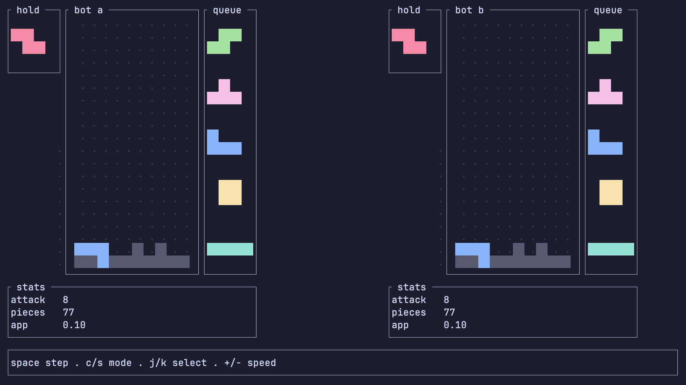

# lion

**Lion** is both a bot that plays and an engine for modern Tetris.



<sub>Dellacherie bot with beam search (depth 3, width 16) bot playing Tetris via the TUI, debounced at 100ms</sub>

## Results

- Greedy bot survives 100k pieces in zen mode (hard-drop, one piece preview + hold piece, hand-picked weights)
- Greedy bot with zero bumpiness weight completes only 6 of 100 games in 40L (same setup as above)
- [Dellacherie bot](https://arxiv.org/pdf/1905.01652) with BFS move generation averages a max height of 4.64 and max at 7.00 across 100 games, median of 102 pieces
- Dellacherie bot with beam search averages a max height of 4.29 and max at 5.00 across 100 games, median of 102 pieces
- Attack-aware beam beats the survival (Dellacherie bot) with beam 134-65-1 over 200 games (67%, 95% CI 60% to 73%, about +125 Elo), commited at 0551d82. [CSV](benchmarks/2026-11-26-attack-vs-survival.csv)

## Recording

Right now, I use [VHS](https://github.com/charmbracelet/vhs) to generate GIFs of the bots playing through the TUI, built with [Ratatui](https://ratatui.rs/).

<sub>*After the introduction of bot lookahead, the viewer has not been updated to support multi-step searches. The preview will show the first move of the sequence.</sub>

To create recordings via the TUI, see the `viewer.tape` script [here](docs/media/viewer.tape).

## Quickstart

Play the bots against themselves:
```
cargo run --release -p arena -- --label "$(git describe --always --dirty)" --games=200 --csv 2026-11-26-attack-vs-survival.csv versus --bot-a ./bots/beam-3d-16w-with-attack.toml --bot-b ./bots/dellacherie-with-beam-3d-16w.toml
```

Switch the crate from `arena` to `viewer` to watch them play in the terminal.

## Status

**Completed**
- Bitboard board representation
- Deterministic 7-bag generation
- SRS engine (kicks, spin detection)
- Greedy heuristic bot with one-piece + hold depth
- Headless arena
- Solo TUI viewer
- Statistics library
- CSV session export
- Complete move generation
- Bot lookahead via beam search
- Dellacherie feature set bot
- Benchmarking with Criterion
- Bot creation via TOML files
- Garbage system (TETR.IO-style attack table, combo, b2b, cancelling, and delay)
- Attack-aware beam search bot
- 1v1 versus arena with seat-swappable matches
- Match statistics (W/D/L, Wilson interval, Elo difference)
- Versus TUI viewer
- Profiled move generation (3.4 to 4.3x faster with identical play, write-up in progress)
- Attack vs survival benchmark (200 games)

**In progress**
- Seat-swapped evaluation (when bots are not tick-based)
- Garbage messiness
- Dynamic bot names through config files
- Parallel match runner
- Parallel beam search

## Contributing

Pull requests and suggestions are welcome! Please open an issue to discuss your ideas or report bugs.

## License

[LICENSE](LICENSE)
